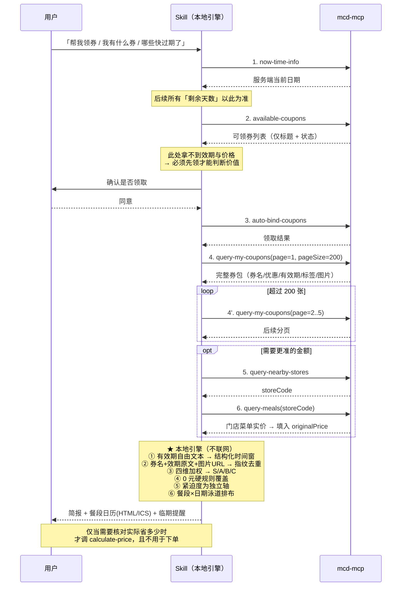

# MCP 集成说明

本 Skill 的全部券数据来自麦当劳官方 MCP Server（`mcd-mcp`）。
本地只做**解析、分级、排期、去重、提醒**，不缓存券包、不猜测金额、不替用户下单。

---

## 一、Server 配置

配置文件：`mcp-config.example.json`

```json
{
  "mcpServers": {
    "mcd-mcp": {
      "type": "streamablehttp",
      "url": "https://mcp.mcd.cn",
      "headers": {
        "Authorization": "Bearer ${MCD_MCP_TOKEN}"
      }
    }
  }
}
```

**Token 处理原则**：仓库内只保留 `${MCD_MCP_TOKEN}` 占位符。
真实 Token 通过环境变量注入，**绝不提交到版本库，绝不写入任何文档或对话记录**。

在 WorkBuddy 中安装：左侧边栏【专家·技能·连接器】→【连接器】→ 右上角【自定义连接器】→【配置 MCP】，
填入上述 JSON（替换占位符）并保存 → 回到自定义连接器列表【启用】`mcd-mcp`。

---

## 二、使用的 7 个工具

### 核心链路（每次运行必调）

| # | 工具名 | 参数 | 作用 | 在本 Skill 中的职责 |
|---|---|---|---|---|
| 1 | `now-time-info` | 无 | 获取服务端当前完整时间 | **唯一的「今天」来源**。禁止用本机日期推断，否则临期判断与日历会整体偏移 |
| 2 | `available-coupons` | 无 | 查询当前可领取的券 | 发现「能领但还没领」的券。**只返回标题+状态，没有效期也没有价格** |
| 3 | `auto-bind-coupons` | 无 | 一键领取全部可领券 | 把「看不见的券」变成「可见的券」。**用户未明确要求时先问一句再执行** |
| 4 | `query-my-coupons` | `page=1, pageSize=200` | 查询已领取的完整券包 | **唯一完整数据源**：券名 / 优惠 / 有效期 / 领取时间 / 标签 / 图片。超过 200 张时继续翻页 `page=2..5` 并合并 |

### 可选增强（让「省了多少钱」更准）

| # | 工具名 | 参数 | 作用 | 在本 Skill 中的职责 |
|---|---|---|---|---|
| 5 | `query-nearby-stores` | `searchType` / `city` / `keyword` | 查询附近门店 | 取 `storeCode`，为第 6 步做准备 |
| 6 | `query-meals` | `storeCode` 等 | 查询门店菜单与价格 | 把券名匹配到商品，取出**门店实价**填入券的 `originalPrice`，替换掉估算基线 |
| 7 | `calculate-price` | `items` + `couponId` / `couponCode` | 计算含优惠的应付金额 | **真实到手价的口径来源**。本 Skill 不调它下单，只在需要校验「到底省多少」时用它做权威核对 |

> 第 5–7 步是**可选增强**。不调也能跑完整流程，此时「省了多少钱」退回
> `data/tiering_config.json` 里的原价基线估算，并在输出中明确标注为估算值。

### 明确不调用的工具

`create-order`、`cancel-order` **不被本 Skill 调用**。
本 Skill 的边界是**券的资产运营**（领券、分级、排期、提醒），不代替用户下单。
点餐搭配与实价求解属于「麦麦多快好省」Skill 的职责。

---

## 三、调用时序



**为什么必须「先领后查」**：`available-coupons` 不返回有效期和价格，
**没领的券等于看不见的券**——用户最典型的损失就是「有一张 0 元汉堡券，但从没领过」。
所以 `available-coupons → auto-bind-coupons → query-my-coupons` 是一条不可拆的链路。

---

## 四、业务价值：解决了什么人工难以完成的问题

### 1. 券的有效期是自由文本，不解析就无法回答「我中午去能用哪张」

`query-my-coupons` 的「有效期」字段实测至少混用 4 种形态：

```
2026-09-24 10:30-2026-12-31 23:59 10:30-23:59 00:00-04:59   ← 日期区间 + 每日时段（含跨零点）
2026-09-24 00:00-2026-12-31 23:59                            ← 纯日期区间
2026-10-11 05:00-2026-10-11 10:29 周日 05:00-10:29           ← 单日 + 星期限定 + 时段
```

人工看一遍只能记住「大概这几天」，而麦当劳的券**大量是餐段限定的**：
早餐券只能 05:00–10:30 用，夜宵券跨零点。`coupon_parser.py` 把这四种形态统一
解析成 `日期区间 + 星期限定 + 每日时段列表`，才能回答「这周三中午能用哪几张」。

### 2. 券包没有 `couponId`，同一张券会重复出现，且无法判断「新券」

返回体里没有任何稳定 ID。若不处理，两个后果：

- 同一张券被重复计数，简报里的「券包 20 张」是虚的；
- 无法回答「这次有没有领到新券」，「新券提醒」也就无从谈起。

本 Skill 用 `券名 + 有效期原文 + 图片URL` 的哈希做**指纹**，
一次性解决 **去重 / 新券识别 / 台账追踪** 三件事——同一个指纹复用一生，
所以「这张券上次提醒过没有」是可判定的。

### 3. 券面金额语义不固定，「省了多少钱」不能直接读

`9.9元中杯冰美式` 的 `¥9.9` 是用券**价格**；
`4折麦辣三件套券` 的 `¥4` **语义不明**（既不是价格也不是折扣绝对值）。

本 Skill 的规则是：**只有文本明确写着「用券价格」才采信该数字**，
其余一律用券名里的折扣率反推到手价，反推不出来就标「金额未知」。
**宁可不给数字，也不给一个错数字**——因为错数字会直接误导用户去哪儿消费。

### 4. 「值钱」和「快过期」是两个轴，混在一起会让分级失效

如果按「价值 + 临期加成」算一个总分，一张只剩 1 天的 0 元薯条券
会被临期加成抬成「极品券」，S 级的含义就被稀释了。

本 Skill 把两者拆开：
- **价值分**只回答「这张券值不值钱」（四维加权：省了多少钱 / 品类权重 / 折扣力度 / 渠道通用性）；
- **紧迫度**只回答「该不该现在动手」（剩余天数 → 特急/临期/留意/正常）。

最终排序 = 先按紧迫度分桶、桶内按价值降序，**直接回答「我现在最该先用哪张」**。

### 5. 0 元券必须走硬规则，不能交给加权求和

实测同样一张券：0 元中薯条按四维加权只有 0.613、奶香大米派只有 0.520，
两张都被**压在 A 级**——原因是「免费」只是折扣分里的一个取值，
被品类权重（小食 0.4）和金额上限（`savingCap=30`）稀释掉了。

但「不花钱拿到一份薯条」显然强过任何 5 折券。所以「免费」被提升为**独立硬规则**：
命中即锁定 S 级、`valueScore` 拉平到 1.0、**不依赖原价基线**（原价未知也照判极品，
因为「不花钱拿到」是事实，不需要估价）。

识别走三级信号（硬→软）：券面写明「用券价格 ¥0」→ 券名含「免费/免单/白送/零元/0元」→ 折扣率为 0。
同时排除三类误判：`10元` 里的 `0元`（负向后顾）、`0元起`（营销话术）、买一送一（那是 5 折不是免费）。

### 6. 提醒不能重复，否则用户会关掉它

临期提醒最大的敌人不是「不提醒」，而是**反复提醒同一张券**。
本 Skill 用台账 `data/coupon_ledger.json` 记录每张券指纹的
`首见日 / 最后出现日 / 已提醒档位`，同一张券同一档位只提醒一次。

配套的工程约束：定时任务必须复用同一台账路径，否则每次都会把全部券当成「新领」。

### 7. 「领券」这个动作本身就该被自动化

`available-coupons` 里的券是「可以领但还没领」的。
用户不开 App 就永远看不见它们，而券是**会过期**的——
这正是「没时间去领、直接买又太贵」的根因。
本 Skill 把这条链路做成一条命令，把随机性（想起来才领）变成确定性（每天自动领全）。

---

## 五、数据落地的字段映射

`query-my-coupons` 每条记录 → 本地 coupon JSON：

| JSON 字段 | 来源 | 规则 |
|---|---|---|
| `name` | 券标题 | 原样复制 |
| `validityText` | 有效期 | **原样复制，一个字都不改**，解析器依赖原文形态 |
| `priceText` | 优惠 | 原样复制，保留 `¥` 与括号说明 |
| `receivedText` | 领取时间 | 如「3日前收到」 |
| `tags` | 标签 | 拆成数组，如 `["到店专用","外送专用"]` |
| `imageUrl` | 图片地址 | 参与指纹计算 |
| `originalPrice` | 可选 | 由 `query-meals` 匹配到的门店实价 |

**三条禁令**：不把 `¥4` 自作主张解读成「省 4 元」；不把有效期手工规整成统一格式；
不凭印象补字段（漏了 `validityText` 这张券就没有效期）。

---

## 六、边界与免责

- 本 Skill **只做券的资产管理**（领券、分级、排期、提醒），**不自动下单**，
  不调用 `create-order` / `cancel-order`。
- 原价基线是**估算值**，不是官方标价；真实到手价以 `calculate-price` 的结果为准。
- 取不到原价时明确标「金额未知」，不猜数字。
- 券信息、价格及供应状态以麦当劳官方渠道的实时结果为准。
