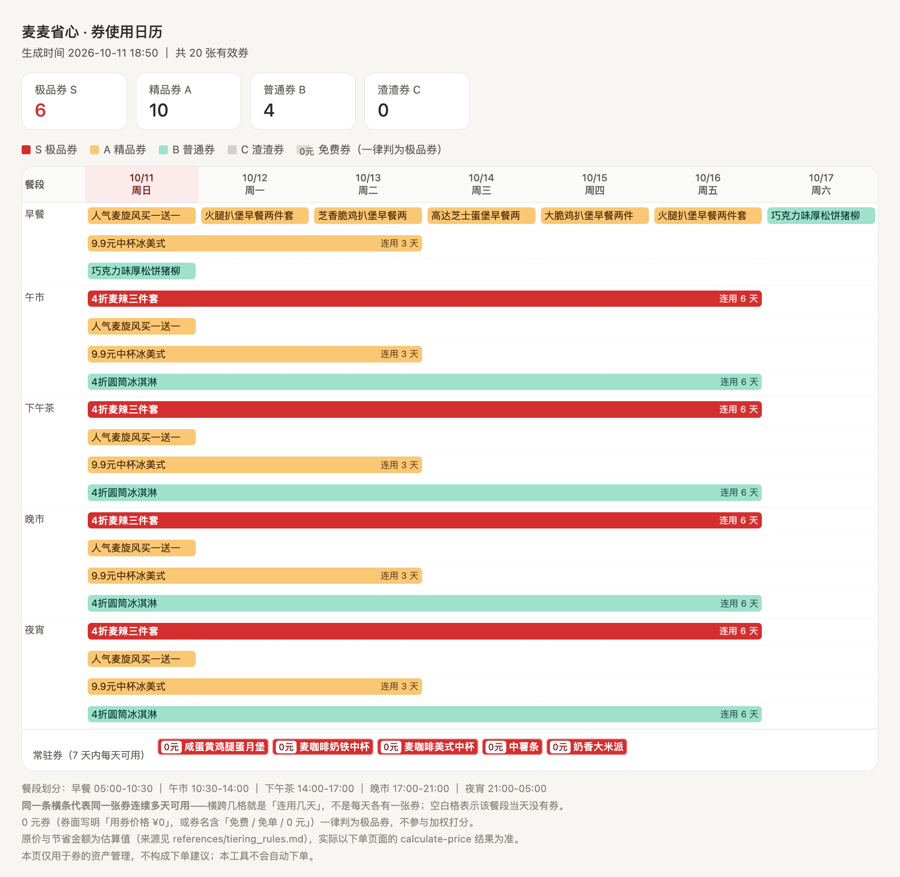

# 麦麦省心 (mcd-coupon-keeper)

> 懒人福音，一次设定，永久躺平 —— 你只管吃，省的事交给它。

麦当劳优惠券的**自动托管工具**——基于麦当劳官方 MCP Server 构建的 WorkBuddy Skill。

**自动领券 → 价值分级 → 餐段日历 → 临期提醒**，一条命令跑完。

- **懒**：不用你记得领，也不用你记得用；
- **自动**：设一次定时任务，之后每天自己跑，你什么都不用管；
- **省钱**：0 元券一张不漏，该用的券都在过期前被提醒到。

**只做券的资产管理，不自动下单。**

---

## 三十秒看懂它是怎么替你省的

```
你（一次设定）        →  每天 07:00 自动跑
                          ├─ 把能领的券全领了        ← 不用你开 App
                          ├─ 按价值分成 S/A/B/C     ← 不用你判断哪张划算
                          ├─ 排进餐段日历           ← 一眼看清中午能用哪张
                          └─ 极品券到期前 3 天提醒  ← 不用你盯有效期
你（收到简报）        →  该用哪张、什么时候用，直接照做
```

---

## 它解决什么问题

| 痛点 | 解法 |
|---|---|
| 券太多，没时间一张张领 | 一条命令把可领券全部领完（`available-coupons → auto-bind-coupons`） |
| 直接买太贵，不知道哪张券划算 | 四维加权分成 **S 极品 / A 精品 / B 普通 / C 渣渣**，直接告诉你先用哪张 |
| 高价值券过期了才发现 | 生成「餐段 × 日期」使用日历，极品券**过期前 3 天**提醒 |
| 0 元券混在一堆券里看不出来 | 0 元免费券**一律判为极品券**，并在简报与日历里单独标红 |
| 同一张券反复提醒，最后干脆不看 | 台账按指纹去重，同一张券同一档位只提醒一次 |
| 有券但不知道「现在去能不能用」 | 有效期自由文本解析成结构化时间窗，按 5 个餐段排期 |

---

## 目标用户

- **懒得管券的人**——不想开 App 领券、不想算哪张划算、不想记有效期，只想收到结论；
- **每周吃 2 次以上麦当劳、但没空管理券包的人**——券是免费的，漏掉就是真金白银；
- **对价格敏感的学生与上班族**——早餐券、9.9 元咖啡券、0 元小食券是他们最常用的品类；
- **餐段固定的人**——只在早上路过门店、或只吃夜宵，需要按餐段筛券而不是按天筛券；
- **想把省券这件事彻底自动化的人**——本 Skill 不内置任何定时任务，周期完全交给使用者；
- **想二次开发券策略的人**——分级权重、原价基线、免费规则全部在 JSON 配置里，改配置不用改代码。

---

## 效果预览

`calendar.html` 是一张「餐段 × 日期」的使用日历：



- 横轴是未来 7 天，纵轴是 5 个餐段（早餐 / 午市 / 下午茶 / 晚市 / 夜宵）；
- **同一张券连续多天可用时渲染成一条横跨多格的长条**，右端标「连用 N 天」；
- 颜色即等级，极品券是实心红底白字，一眼跳出来；
- 覆盖整个窗口的长期券收进底部「常驻券」栏，不刷屏。

配套的 `calendar.ics` 可以直接导入手机系统日历，S 级券自带「到期前 3 天」闹钟。

---

## 安装方法

### 前置条件

1. 已安装 **WorkBuddy**；
2. 已申请到**麦当劳 MCP Token**：

   - 打开麦当劳 MCP Server 站点，右上角【登录】，用手机号完成验证；
   - 登录后右上角【登录】变为【控制台】，点开控制台弹窗；
   - 点【激活】申请 MCP Token，阅读并同意服务协议；
   - 申请成功后一键复制 Token。

### 第一步：配置 MCP 连接器

在 WorkBuddy 左侧边栏【专家·技能·连接器】→【连接器】→ 右上角【自定义连接器】→【配置 MCP】，
填入下面内容（**把 `YOUR_MCP_TOKEN` 换成你的真实 Token，然后保存**）：

```json
{
  "mcpServers": {
    "mcd-mcp": {
      "type": "streamablehttp",
      "url": "https://mcp.mcd.cn",
      "headers": {
        "Authorization": "Bearer YOUR_MCP_TOKEN"
      }
    }
  }
}
```

回到【自定义连接器】列表，把 `mcd-mcp` **启用**。
仓库内的 `mcp-config.example.json` 是同一份配置的脱敏版本，只含 `${MCD_MCP_TOKEN}` 占位符。

### 第二步：安装本 Skill

```bash
git clone <本项目仓库地址> ~/.workbuddy/skills/mcd-coupon-keeper
```

或直接把本项目目录放到 `~/.workbuddy/skills/mcd-coupon-keeper/`。

### 第三步：验证环境（不需要联网、不需要 MCP）

```bash
cd ~/.workbuddy/skills/mcd-coupon-keeper
python3 scripts/mcd_coupon_keeper.py selftest --today 2026-10-10
```

用内置样例数据跑完整流水线，预期输出：18 张券、S=8、免费券全部判为极品券、提醒 1 条。

**依赖：纯 Python 标准库，Python 3.8+，不需要安装任何第三方包。**

---

## 使用示例

### 示例 1：直接用对话触发（推荐）

安装好之后，在 WorkBuddy 里直接说：

> 帮我看看我有什么券，哪些快过期了。

Skill 会自动完成五步：取服务端时间 → 领券 → 拉券包 → 跑分析 → 出简报和日历。

其它触发说法：

- 「帮我领券」
- 「这个月的券怎么用」
- 「哪张券划算」
- 「券什么时候能用」
- 「极品券提醒」

### 示例 2：手动跑命令行

```bash
# 1) 把 query-my-coupons 的结果整理成 coupons.json
#    （字段映射见 references/mcp_collection.md）

# 2) 一步跑完整条流水线
python3 scripts/mcd_coupon_keeper.py all --input coupons.json --outdir out/

# 3) 也可以只跑其中一步
python3 scripts/mcd_coupon_keeper.py parse    --input coupons.json --out parsed.json
python3 scripts/mcd_coupon_keeper.py tier     --input parsed.json  --out tiered.json
python3 scripts/mcd_coupon_keeper.py alert    --input tiered.json  --out alerts.json
python3 scripts/mcd_coupon_keeper.py calendar --input tiered.json  --outdir out/
```

产出：

| 文件 | 用途 |
|---|---|
| `out/report.md` | 简报，直接读给用户听（总览 / 提醒 / 优先级排序） |
| `out/calendar.html` | 「餐段 × 日期」日历，双击即可看 |
| `out/calendar.ics` | 导入手机日历，S 级券自带 T-3 提醒 |
| `out/tiered.json` | 分级明细，供二次处理 |
| `out/alerts.json` | 新券与提醒清单 |

### 示例 3：设定时任务（周期自定）

本工具**不内置任何定时任务，也不预设输出频率**。用 WorkBuddy 的定时任务功能自行创建即可：

| 场景 | 建议频率 |
|---|---|
| 每天自动领券 + 简报 | 每天 1 次（想赶在早餐时段前用券，可设 07:00） |
| 只在有极品券临期时看 | 每天 1 次（简报里没有提醒段落时可忽略） |
| 每周盘点一次券包 | 每周 1 次 |

> 定时任务必须**复用同一个台账路径**（`data/coupon_ledger.json`），
> 否则每次都把全部券当成「新领」。

---

## 它解决的核心难题

### 1. 券的有效期是自由文本

`query-my-coupons` 的「有效期」实测至少混用 4 种形态：

```
2026-09-24 10:30-2026-12-31 23:59 10:30-23:59 00:00-04:59   ← 日期区间 + 每日时段（含跨天）
2026-09-24 00:00-2026-12-31 23:59                            ← 纯日期区间
2026-10-11 05:00-2026-10-11 10:29 周日 05:00-10:29           ← 单日 + 星期 + 时段
```

不解析成结构化时间窗，就没法回答「我中午去能用哪张券」。
`coupon_parser.py` 把它们统一成 `日期区间 + 星期限定 + 每日时段列表`。

### 2. 券面金额的语义不固定

`9.9元中杯冰美式` 的 `¥9.9` 是用券**价格**；
`4折麦辣三件套券` 的 `¥4` **语义不明**。

只有写明「用券价格」的才当价格用，其余交给券名里的折扣率反推。
**宁可标「金额未知」，也绝不把一个含义不清的数字当成「省了多少钱」。**

### 3. 券没有 ID，同一张券会重复出现

返回体里没有 `couponId`。本工具用 `券名 + 有效期原文 + 图片URL` 的哈希做指纹，
一次性解决**去重、新券识别、台账追踪**三件事。

### 4. 「值钱」和「快过期」是两件事

分级只看**价值**（四维加权：省了多少钱 / 品类 / 折扣力度 / 渠道通用性）；
**紧迫度是独立的轴**，只决定排序与是否提醒。

拆开的原因：混在一起的话，一张「只剩 1 天的 9.9 元咖啡券」会因为临期加成被抬成极品券。

最终排序 = 先按紧迫度分桶，桶内按价值降序，同分再按省下的钱降序
—— 直接回答「我现在最该先用哪张」。

### 5. 0 元券必须走硬规则，不能靠打分

**0 元券一律判为极品券。**

为什么不交给加权分：四维求和会被**品类权重和金额上限稀释**。
实测同样的券，硬规则上线前——0 元中薯条只有 0.613、奶香大米派只有 0.520，
两张都被压在 A 级。但「不花钱拿到一份薯条」显然强过任何 5 折券。

`detect_free()` 单独识别免费（券面「用券价格 ¥0」/ 券名「免费、免单、0 元」/ 折扣率 0），
命中即锁定 S 级、`valueScore` 拉平到 1.0，**且不依赖原价基线**。

已排除的误判：`10元` 里的 `0元`、「0元起」营销话术、以及「买一送一」（那是 5 折，不是免费）。

在 `data/tiering_config.json → freeCoupon` 里可关闭（`enabled: false`）或改档。

---

## 为什么用「餐段 × 日期」日历

麦当劳的券大量是**餐段限定**的：早餐券只能 05:00–10:30 用，夜宵券跨零点。

普通月历只能告诉你「今天有券」，回答不了「我中午去能用哪张」。
所以日历做成二维网格：横轴是未来 7 天，纵轴是 5 个餐段，格子里是该餐段能用的券。

**同一张券连续多天可用时渲染成一条横跨多格的长条**，右端标「连用 N 天」，
而不是每天重复一个小券块——后者会被误读成「每天都领到一张新券」。
同一餐段里日期不冲突的券排在同一排，冲突的才换行。

覆盖全部 7 天的券会被收进「常驻券」栏，避免长期券刷屏。

---

## 调参

所有阈值都在 `data/tiering_config.json`，改配置不用改代码：

| 你的感受 | 改哪里 |
|---|---|
| 不想让免费券自动判极品 | `freeCoupon.enabled = false` |
| 免费券想判成 A 而不是 S | `freeCoupon.forceGrade` |
| 大额券之间区分度不够 | 调高 `savingCap` |
| 咖啡券给太高了 | 调低 `categoryScores.drink` |
| 整体偏严 / 偏松 | 平移 `grades` 里的 `min` |

原价基线（`priceBaseline`）是估算值，条目可带 `category` 做品类约束。
**建议跑一两周后按你真实的券包校准。**

---

## 目录结构

```
mcd-coupon-keeper/
├── README.md                   本文件（项目介绍 / 安装 / 使用示例 / 目标用户）
├── CONTEST_DECLARATION.md      参赛声明（官方原文，内容不可改动）
├── MCP_INTEGRATION.md          MCP Server / Tool / 调用流程 / 业务价值
├── mcp-config.example.json     脱敏 MCP 配置示例（仅环境变量占位符）
├── workbuddy.md                WorkBuddy 开发对话上下文
├── SKILL.md                    Skill 主文档：铁律、工作流、输出模板
├── scripts/
│   ├── mcd_coupon_keeper.py    统一入口（all/parse/tier/alert/calendar/selftest）
│   ├── coupon_parser.py        有效期与券名解析
│   ├── value_tier.py           价值分 + 分级 + 紧迫度
│   ├── calendar_builder.py     HTML + .ics 生成
│   └── alert_checker.py        台账去重与提醒
├── data/
│   ├── tiering_config.json     权重 / 阈值 / 原价基线
│   ├── sample_coupons.json     样例数据（供离线自测）
│   └── coupon_ledger.json      台账（运行时记忆，勿删）
└── references/
    ├── coupon_schema.md        实测字段与三个坑
    ├── tiering_rules.md        分级公式与调参
    └── mcp_collection.md       MCP 采集与字段映射
```

---

## 免责

- 本项目为**麦当劳程序员节创意开发大赛参赛作品**，由参赛者独立开发，**非麦当劳官方产品**。
- 原价基线是**估算值**，不是官方标价；真实到手价以点单页面的 `calculate-price` 为准。
- 取不到原价时明确标「金额未知」，不猜。
- 本工具只做券的资产管理，**不构成下单建议，也不会自动下单**。
- 券信息、价格及供应状态以麦当劳官方渠道的实时结果为准。
